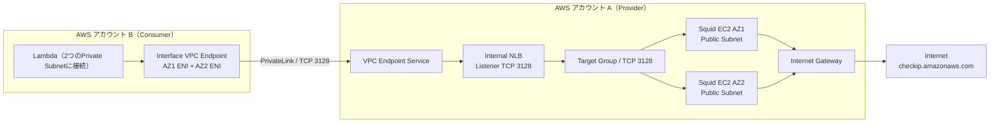

# AWS PrivateLink × Squid — 2AZ プロキシ検証環境

ログ収集を追加する拡張版は、[logging/README.md](./logging/README.md)を参照してください。既存テンプレートを残し、Kinesis Agent・Firehose・S3の構築と少量検証を追加しています。ログ収集の環境・証跡は、明示的な削除指示まで保持します。

2つの AWS アカウント間で **AWS PrivateLink** を使い、インターネットへの直接経路を持たない Lambda から、別アカウントの Squid プロキシ経由で HTTPS 通信するための CloudFormation サンプルです。

- **B（利用側）**: プライベートサブネット × 2、Interface VPC Endpoint × 1（ENI × 2）、Lambda × 1
- **A（提供側）**: パブリックサブネット × 2、Squid EC2 × 2、internal NLB × 1（Target Group、Listener 含む）、Endpoint Service × 1、Internet Gateway × 1
- **リージョン**: `ap-southeast-2`（シドニー）を想定。AZ ID は `apse2-az1` と `apse2-az2`（AZ **名**はアカウントによって異なる場合があります）
- **目的**: 検証・学習用。**本番運用向けの汎用・高可用性プロキシではありません**

## 構成と通信方向

### AZごとの配置と命名規則

| 用途 | AZ1 (`apse2-az1`) | AZ2 (`apse2-az2`) |
|---|---|---|
| A サブネット（VPC `10.240.0.0/16`） | `PublicSubnetAz1` / `10.240.1.0/24` | `PublicSubnetAz2` / `10.240.2.0/24` |
| A EC2 | `SquidInstanceAz1` / Name: `privatelink-proxy-lab-squid-az1` | `SquidInstanceAz2` / Name: `privatelink-proxy-lab-squid-az2` |
| A サブネット関連付け | `PublicSubnetAz1RouteAssociation` | `PublicSubnetAz2RouteAssociation` |
| B サブネット（VPC `10.241.0.0/16`） | `PrivateSubnetAz1` / `10.241.1.0/24` | `PrivateSubnetAz2` / `10.241.2.0/24` |
| B Interface Endpoint | **1つの** VPC Endpoint の AZ1 ENI | 同じ VPC Endpoint の AZ2 ENI |
| B Lambda | **1つの**関数で2つのサブネットに接続 | 別の関数を作らない |

`Name` タグも AZ1・AZ2 で対称的になるよう統一しています。両 VPC は同一VPCではなく、アカウント別に独立しています。

## ファイル

- [`01-provider-a.yaml`](./01-provider-a.yaml): A側。VPC、2 public subnet、ルートテーブル、IGW、EC2/Squid×2、NLB、Target Group、Listener、Endpoint Service、SG、SSM IAM ロール
- [`02-consumer-b.yaml`](./02-consumer-b.yaml): B側。VPC、2 private subnet、Interface VPC Endpoint（2AZ）、Lambda、IAM ロール、CloudWatch Logs、SG

## デプロイ手順（新規スタック用）

この公開用テンプレートは **削除済みの検証環境を再作成するための新規構築版** です。既存の旧1AZスタックを更新する用途には使わないでください。論理ID変更によりリソース置換・削除が発生し得ます。

1. **A側のアカウント**（シドニー）で CloudFormation を開き、`01-provider-a.yaml` から新しいスタック（例: `pl-proxy-provider-lab`）を作成します。パラメータ `ConsumerAccountId` に、**B側の自分のAWSアカウントID** を入力してください（テンプレートに実際のIDは埋め込んでいません）。`ProviderAzId1` と `ProviderAzId2` を確認します。必要に応じて IAM リソース作成の確認を行います。
2. A側スタックが `CREATE_COMPLETE` になったら、Outputs の `ServiceName` を控えます。NLB ターゲットグループで Squid 2台が `healthy` になっていることを確認します。
3. **A側 VPC → Endpoint services** で Endpoint Service の **サポート対象AZ** が2つとも表示されることを確認してください。NLBが2AZでも既存サービスに自動反映されない場合があります。必要なら NLB の関連付け設定を再保存して反映します。AZ名でなく **AZ ID** で照合してください。
4. **B側のアカウント**（同リージョン）で `02-consumer-b.yaml` を新規スタック（例: `pl-proxy-consumer-lab`）として作成し、`ServiceName` に A側 Outputs の値を入力します。`ProviderAzId1` / `ProviderAzId2` は A側に合わせます。
5. A側 VPC → Endpoint services → Endpoint connections から、B側の接続を手動承認します（`AcceptanceRequired: true` のため）。B側の Endpoint が `Available`、Lambdaが2サブネットに接続していることを確認します。
6. B側 Lambda（CloudFormation Outputs の `TestLambdaName`）でイベント `{}` をテストします。`success: true`、`http_status: 200` が返れば疎通成功です。送信元のIPは A側 Outputs `ProxyPublicIpAz1` または `ProxyPublicIpAz2` のいずれかになります。

> **注意**: Lambda の1回の成功では AZ 障害時の自動切替までは証明できません。NLB ヘルスチェックが TCP 成功でも、Squid の外部通信に問題がない保証にはなりません。

### 構築直後の通信エラーについて

2026-11-03 の再構築検証では、B 側の VPC Endpoint が `Available`、A 側 NLB のターゲット 2 台が `healthy` でも、Lambda が一時的に `URLError: [Errno 16] Device or resource busy` を返しました。その後、設定・コードを変更せずに再実行して成功し、追加の 5 回も連続成功しています。

原因は特定できていないため、必ずしも PrivateLink の承認や伝播遅延が原因とは限りません。発生時は Endpoint 接続状態、NLB ターゲット、DNS 名前解決、TCP/3128 の接続を順に確認してください。単発の失敗だけでセキュリティグループを開放したり、スタックを作り直したりしないでください。

## セキュリティ上の制約

- B側VPCには Internet Gateway / NAT Gateway を設置せず、Lambda は Interface VPC Endpoint 経由で接続します。
- B側 Endpoint SG は Lambda SG からの **TCP/3128** のみ受信します。Lambda SG には受信規則がありません。
- A側 NLB は **internal**。NLB SG は指定したB側の2サブネットからの TCP/3128 に限定し、PrivateLink トラフィックに対するSG受信ルール適用を有効にしています。
- Squid EC2 SG は NLB SG からの TCP/3128 だけを受信し、SSH（TCP/22）を開放しません。
- Squid は **`checkip.amazonaws.com` へのHTTPS CONNECT（443）** のみ許可する検証用設定です。公開プロキシとして外部サイトへ無制限に転送する設定ではありません。
- Endpoint Service は `ConsumerAccountId` で許可した AWS アカウントだけに接続権限を付け、**接続承認は手動**です。
- EC2にはパブリックIPv4が割り当てられ、Internet Gateway を経由して外部へ通信します。**Elastic IPは使用しません**。EC2を停止してから起動すると送信元IPが変わり得ます。固定送信元IPが必須の用途にはそのまま使えません。
- IAM、ネットワーク、監査設定、踏み台不要アクセス（SSM）、Squid 設定はユースケースに合わせて追加レビューしてください。本番向けの可用性設計・監視・自動置換は含まれません。

## 公開リポジトリでの取り扱い

このリポジトリには、**実際のアカウントID、VPC ID、サブネットID、VPC Endpoint/Service ID、パブリックIP、認証情報、実行ログ、コンソールのスクリーンショット**を含めていません。`ConsumerAccountId` / `ServiceName` は、デプロイ時に手入力するパラメータです。

**公開前**に、手元で追加した設定ファイル・スクリーンショット・実行履歴を含めて再確認してください。AWSアカウントIDやネットワークCIDRは通常それだけで認証用の秘密ではありませんが、不要な実環境情報は公開しない方針にしています。テンプレートをパブリック公開する場合も、各自の AWS で安全に実行できることを保証するものではありません。

このリポジトリは **新規作成用** です。実行済みテンプレートからの差分反映や既存システムへの適用は、Change Set を必ず確認してください。

## 課金と削除

この節は元の2AZプロキシ検証テンプレートが対象です。ログ収集拡張の保持・削除方針は[logging/README.md](./logging/README.md#上限費用保持)を参照してください。

EC2×2（EBS・パブリックIPv4を含む）、NLB、Interface Endpoint のAZごとのENIなどに継続料金が発生する可能性があります。予算アラートは別途設定してください。自動削除（Guardian）テンプレートは同梱していません。

検証終了後は **① B側スタック → ② A側スタック** の順で削除し、それぞれ `DELETE_COMPLETE` を確認してください。CloudFormation以外で作成したリソースやデプロイ用 S3 オブジェクトは別途確認してください。

## AWS公式ドキュメント

- https://docs.aws.amazon.com/vpc/latest/privatelink/configure-endpoint-service.html
- https://docs.aws.amazon.com/elasticloadbalancing/latest/network/availability-zones.html
- https://docs.aws.amazon.com/AWSCloudFormation/latest/UserGuide/best-practices.html
